# Material Quality Intelligence

[](https://github.com/Thisissun93/Material_Quality_Intelligence/actions/workflows/tests.yml)


반도체 패키징 소재(언더필·에폭시 접착제) 공장의 품질 데이터를 **장비 제조사·펌웨어·단위·언어에 상관없이 자동으로 모으고**, MSA·공정능력·SPC·공급사 품질·원료→제품 예측을 한 번에 분석해 **8D·SCAR·출하 성적서까지 만들어 주는** Streamlit 앱입니다. 재시험 합격으로 최초 부적합을 덮지 못하도록 **OOS 조사 이력**을 관리하고, 출하는 **QA 검토와 승인자 승인, 두 사람의 전자서명**으로 결정하며 그 근거를 그대로 보존합니다.

**▶ [데모 앱 열기](https://materialqualityintelligence-dknsnjemfstfko4zluzplu.streamlit.app/)** (설치 없이 브라우저에서 바로 실행, 한국어/English)

> 모든 데이터는 합성 데이터입니다. 실제 공장처럼 여러 장비 형식과 숨은 문제를 일부러 심어 두었고, 앱이 그 문제를 스스로 찾아내는지 테스트로 검증합니다.

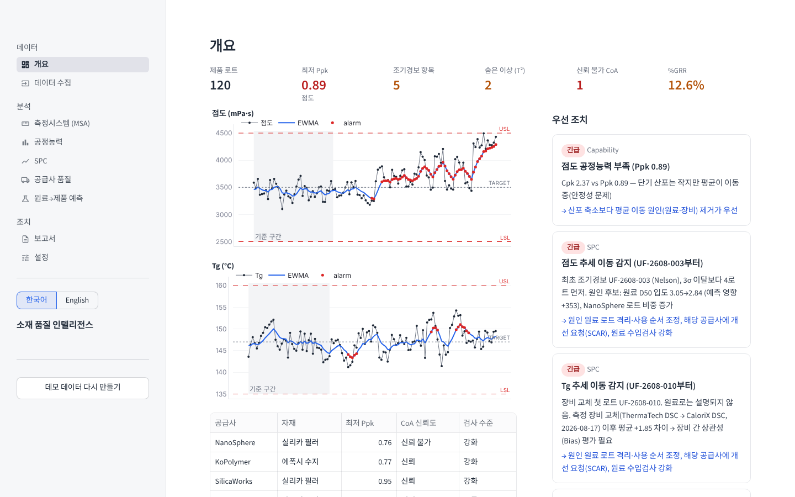

**목차** · [업무 성과](#업무-성과-로트-1건-조사) · [무엇이 다른가](#무엇이-다른가) · [3분 둘러보기](#3분-둘러보기) · [핵심 기능](#핵심-기능) · [심어 둔 문제와 결과](#데모-데이터에-심어-둔-문제와-앱이-찾은-결과) · [실행](#실행) · [서비스로 운영하기](#서비스로-운영하기-postgresql--rest-api--docker) · [검증](#검증) · [구조](#구조) · [English](#english-summary)

## 업무 성과: 로트 1건 조사

클레임이나 OOS가 들어오면 품질 엔지니어는 한 로트에 대해 검사 이력(최초·재시험), OOS 기록, 투입 원료 로트와 공급사, 원료 수입검사·CoA 값, 배치 공정 기록, 설비 런·FDC 알람, 생산일 전후 4M 변경점, 같은 원료를 쓴 다른 로트를 여러 시스템에서 찾아 모읍니다. MQI는 이것을 한 번에 모으고, 고객 클레임이면 클레임 8D 초안까지 만듭니다. 4M 변경점은 로트의 생산일 기준 60일을 봅니다.

| 시나리오 | 로트 | 출하 판정 | 데이터를 가져온 시스템 | 모은 기록 | 수집 시간 |
|---|---|---|---|---|---|
| 고객 클레임 | UF-2611-001 | 보류 | 6곳 | 61건 | 0.16초 |
| 최초 결과 OOS | UF-2610-014 | 불가 | 5곳 | 48건 | 0.05초 |
| 설비 FDC 알람 | UF-2611-003 | 보류 | 5곳 | 60건 | 0.06초 |

| 방식 | 로트 1건 자료 수집 |
|---|---|
| 수작업 | 반나절 가까이 (작성자가 양산 라인에서 실제로 겪은 시간, 계측값 아님) |
| MQI | 분석 1회 약 2~4초 + 로트당 0.2초 이하 (합성 데모 데이터, CPU, 실행마다 조금씩 다름) |

비교는 자료를 모으는 시간에 한정됩니다. 원인 판단과 대책 결정은 사람이 합니다. 측정 방법과 항목별 시간은 [측정 보고서](docs/benchmark_investigation.md), 실제 모은 내용은 [조사 패키지 예시](docs/investigation_example.md)에 있습니다. 다시 재려면 `python scripts/benchmark_investigation.py`.

## 무엇이 다른가

| 일반적인 품질 대시보드 | 이 프로젝트 |
|---|---|
| 정해진 CSV 형식만 읽음 | 처음 보는 장비 파일도 **구조·열 이름·값의 물리적 타당성**으로 판별. 모르는 형식은 한 번 확인하면 학습 |
| 3σ 관리한계 이탈을 표시 | **EWMA·CUSUM·Nelson 8규칙**으로 3σ보다 먼저 경보, 다변량 **T²**로 "단일 값은 정상인데 조합이 이상한" 로트 탐지 |
| 이상을 보여 주고 끝 | **MES 원료 이력(genealogy)**을 따라가 어떤 원료·공급사가 원인인지 수치로 제시 |
| CoA를 그대로 신뢰 | **CoA vs 자사 측정**을 비교해 공급사 성적서의 신뢰도와 "언제부터 어긋났는지" 판정 |
| 장비 교체 영향을 공정 변화로 오인 | **공분산분석(ANCOVA)**으로 원료 영향을 뺀 순수 장비 편차만 분리 |
| 보고서는 사람이 작성 | 데이터로 채운 **표준 8D(D0–D8)·SCAR** 자동 작성: 5W2H·IS/IS NOT, 발생/유출 원인 분리, 6M 검증, 원료 한계 재계산 (한/영, A4·Excel) |
| 결과만 보여 줌 | 재고 원료 조합별 **다음 배치 이탈 확률**을 예측해 사용할 조합을 추천 |
| 조치는 엑셀로 따로 관리 | 8D·SCAR 조치를 **담당·기한·상태**로 추적하고, 상태가 8D D5·D6에 자동 반영 |
| AI 챗봇은 그럴듯하게 지어냄 | **사내 LLM**이 시스템 데이터와 SOP만으로 답하고, 출처와 근거 검사를 함께 표시. 34문항 평가 결과 공개 |
| 설비 데이터는 따로 보고, 검사 합격이면 출하 | 믹서 데이터를 **OPC UA로 자동 수집**해 Step별 FDC 판정. 검사는 합격이어도 설비 이상 이력이 있으면 출하 보류 |
| 재시험 합격이면 그대로 출하 | 최초 결과를 지우지 않고 보존, **OOS 조사**(1단계 실험실 → 2단계 제조)가 끝나기 전에는 출하·성적서 발행 차단 |
| 출하 승인은 체크 한 번, 근거는 남지 않음 | **QA 검토 → 승인자 승인** 두 전자서명. 서명 시점의 근거(검사 이력·OOS·설비·클레임)를 해시와 함께 보관하고, 이후 데이터가 바뀌면 서명은 효력을 잃음 |
| 누가 언제 고쳤는지 모름 | 모든 입력·서명을 **감사 추적**에 기록. DB가 수정·삭제를 거부하고, 행마다 이전 행의 해시를 담아 파일을 직접 고쳐도 드러남 |
| 출하 성적서는 수기 작성 | 출하 판정과 두 서명을 통과한 로트만 **출하 CoA PDF** 발행 (서명자·서명 일시·근거 해시 인쇄) |

## 3분 둘러보기

| 순서 | 화면 | 볼 것 |
|---|---|---|
| 1 | 개요 | 우선 조치 목록: 점도 이동, Tg 장비 편차, CoA 신뢰 불가, 고객 클레임, 최초 결과 이탈 로트 |
| 2 | SPC | EWMA가 3σ보다 4로트 먼저 경보, 차트 위 4M 변경점 |
| 3 | 공급사 품질 → CoA 문서 | NanoSphere 성적서 원본과 자사 측정의 차이 |
| 4 | 원료→제품 예측 | 원인 기여도 1순위 D50, 재고 원료 조합별 이탈 확률 |
| 5 | 보고서 | 데이터로 채운 8D (출발점을 고객 클레임으로 바꿔 보기) → "조치 등록" |
| 6 | 조치·클레임 / 출하 판정·성적서 | 등록된 조치의 상태 관리, 보류 로트와 출하 CoA 발행 |
| 7 | 출하 판정·성적서 → **UF-2610-014** | 첫 점도 4,640(이탈) → 재측정은 합격인데도 출하 불가. `검사 이력 · OOS 조사 · 재시험`에서 조사 등록 → 1단계 종결까지 직접 진행 |
| 8 | 출하 판정·성적서 → **UF-2611-003** | 검사는 모두 합격인데 보류. `설비 이력 (FDC)`에서 TC1만 60℃를 유지하는 동안 TC2·제품 온도가 65℃를 넘은 트렌드 확인 |
| 9 | AI 어시스턴트 | 예시 질문 "UF-2611-003 출하해도 돼?", "OOS 나오면 재시험 바로 해도 돼?", "출하 승인 처리해줘" — 출처와 근거 검사, 거절 확인 |
| 10 | 사이드바 로그인 → 출하 판정·성적서 | **UF-2611-004**는 이미 두 서명이 끝나 정식 CoA가 나옵니다. 이QA(`qa.lee`)로 로그인해 보류 로트 **UF-2611-007**에 판단 근거를 적고 검토 서명 → 박승인(`approver.park`)으로 바꿔 승인 서명 → 정식 CoA 발행. 데모 비밀번호 `demo1234` |
| 11 | 감사 추적 | 방금 한 로그인·전자서명·승인이 해시 체인과 함께 기록된 것 확인 |

## 핵심 기능

### 1. 장비 자동 인식 (Searching → Matching → Choice)
같은 점도라도 장비마다 출력이 다릅니다. 단위(`cP`/`mPa·s`/`Pa·s`), 구분자(콤마/세미콜론/탭), 소수점 콤마(유럽 로케일), 켈빈·ppm 표기, 펌웨어별 열 이름, 한 줄에 한 값(long) 형식이나 `키: 값` 보고서 형식까지 제각각입니다.

1. **Search**: 등록된 모든 장비 프로파일(`config/instruments/*.yaml`)을 파일에 대입합니다.
2. **Match**: 구조 점수(서명 문구·열 이름 유사도·구분자/소수점)와 내용 점수(변환한 값이 물리적으로 말이 되는지)를 합쳐 신뢰도를 냅니다. DSC 파일을 점도계로 잘못 읽으면 내용 점수에서 떨어집니다.
3. **Choice**: 신뢰도와 2순위와의 차이가 충분하면 자동 저장, 애매하면 확인 요청, 처음 보는 형식이면 `config/vocabulary.yaml`(다국어 동의어)로 매핑 초안을 만들어 보여 줍니다. 한 번 확인하면 프로파일로 저장되어 다음부터 자동 인식됩니다.

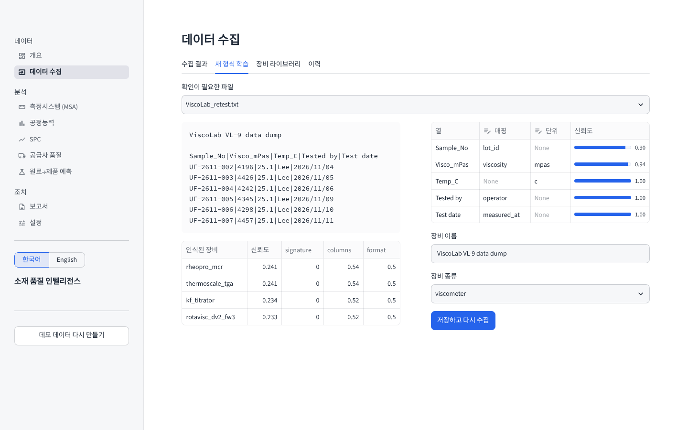

공유 폴더를 감시하면 장비가 파일을 저장하는 즉시 수집합니다.

```bash
python -m mqi.ingest.watcher "D:/LabShare/Exports"
```

공급사 CoA PDF는 표 형식, 검사 성적서 형식 등 양식이 달라도 같은 동의어 사전으로 읽습니다. `공급사 품질 → CoA 문서`에서 원본 PDF와 추출값·자사 측정값·규격을 나란히 보고, 차이가 큰 성적서만 골라 볼 수 있습니다.

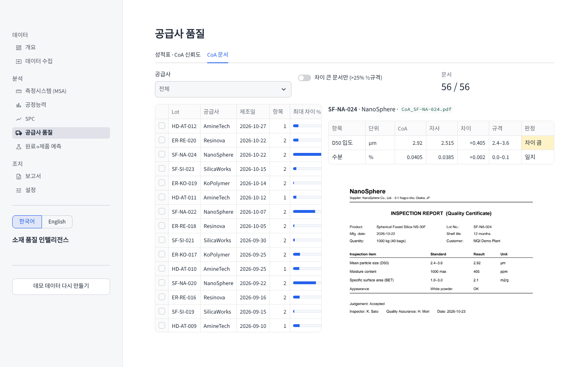

### 2. 분석
| 영역 | 내용 |
|---|---|
| MSA | 교차 Gage R&R (2원 ANOVA, AIAG), %StudyVar·%Tolerance·ndc, 치우친 측정자 식별 |
| 공정능력 | Cp/Cpk(MR̄/d2), Pp/Ppk, Cpk 신뢰구간, 비정규 시 Box-Cox, 이동 Ppk |
| SPC | I 관리도 + Nelson 1–8, EWMA, CUSUM, 방법별 첫 경보 시점 비교, Hotelling T² + 항목별 기여도 |
| 공급사 | CoA 신뢰도(짝 t검정·Bland-Altman·차이 추세), 공급사 성적표(Ppk 95% 신뢰구간), 검사 수준(강화/보통/Skip-lot/판정 보류) 추천. 로트가 적으면 신뢰구간으로 판단해 성급한 강화 판정을 막음 |
| 원료→제품 | 로트 이력 결합 → Ridge/GBM 교차검증 선택 → 원인 기여도, 다음 배치 시뮬레이터, 재고 조합 위험도 순위 |
| 측정 장비 편차 | ANCOVA로 원료 영향을 통제한 장비 교체 Bias |
| 공정 조건 | MES 배치 기록(믹서·진공도·탈포 온도·믹싱 시간·배치 크기)을 원료로 설명 안 되는 편차와 비교 → 8D 6M의 Machine·Method를 데이터로 판정 |
| 4M 변경점 | QMS 변경 이력을 SPC 차트에 표시하고, 이동 시작 전후 변경점마다 원료 보정 후 단차를 검정. 원인 공급사의 변경이 이력에 없으면 "사전 통보 없음"을 시스템 원인으로 기록 |

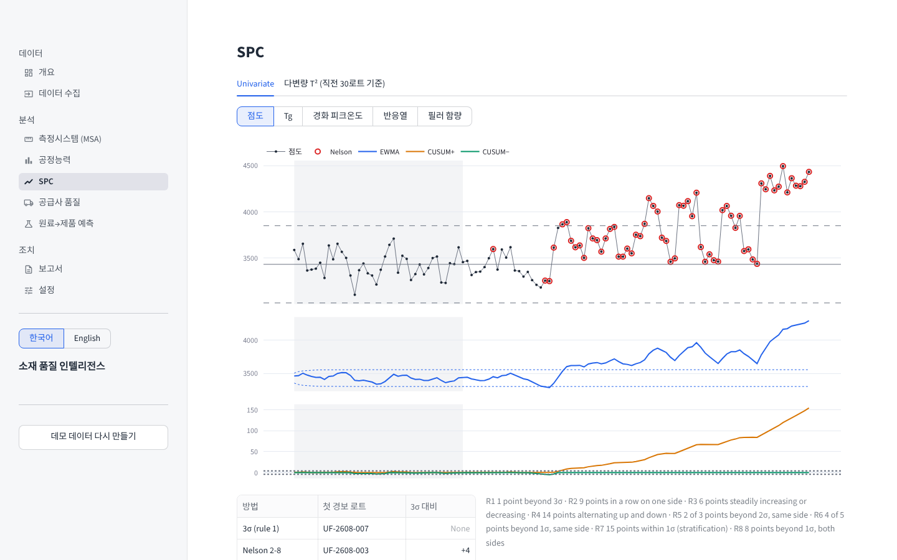

### 3. 조치
판단 기준은 `config/rules.yaml` 한 곳에서 관리합니다. 결과는 근거와 조치가 붙은 우선순위 목록, 8D, 공급사 SCAR, HTML 보고서로 나옵니다.

8D는 Ford G8D / VDA 8D 구성을 따릅니다.

| 단계 | 자동으로 채우는 내용 |
|---|---|
| D0–D2 | 증상·ERA, 기능별 팀, 원인을 가정하지 않은 문제 정의, 5W2H, 데이터 기반 IS / IS NOT (물성·공급사·시점·측정자) |
| D3 | 원료 재고·재공·출하분·고객 단위 봉쇄 수량, 담당, 목표일, 해제 기준 |
| D4 | **발생 원인**과 **유출(미검출) 원인**을 기술적(TRC)·시스템(MRC)으로 분리, 5-Why, 6M 판정, 검증 근거 |
| D5–D6 | 두 원인 각각의 영구 대책과 검증 방법. 원료 수입 한계는 모델로 다시 계산 (예: D50 하한 2.4 → 2.58 µm) |
| D7–D8 | PFMEA·관리계획서 변경안, 표준 개정, 수평 전개, 교훈, 종결 체크리스트 |

원인이 측정 장비로 판정되면(예: DSC 교체) 봉쇄·원인·대책이 측정 시스템 기준으로 바뀝니다. 고객 클레임을 출발점으로 고르면 고객 재고 봉쇄와 24시간 회신 기한이 들어간 클레임 8D가 됩니다. 앱에서 편집한 뒤 A4 HTML(브라우저에서 PDF로 인쇄), Excel 양식, Markdown으로 내려받습니다.

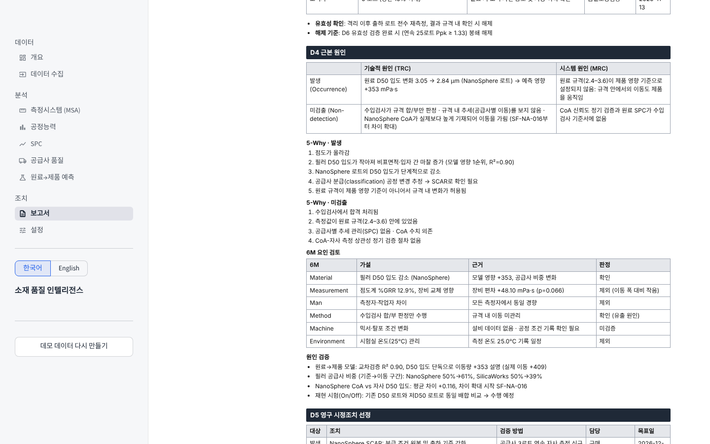

| 화면 | 내용 |
|---|---|
| 조치·클레임 | 8D에서 "조치 등록"을 누르면 D3·D5 조치가 등록됩니다. 담당·기한·상태·메모를 표에서 바로 고치고, 기한이 지나면 표시되며, Excel로 내보낼 수 있습니다. 클레임을 등록하면 클레임 기준 8D로 바로 이동합니다. |
| 출하 판정·성적서 | 최근 로트를 출하 가능 / 보류(규격 경계 5% 이내, T² 이상, 진행 중 클레임) / 불가(규격 이탈·미측정)로 판정합니다. QA 검토와 승인자 승인 서명이 끝난 로트만 정식 CoA PDF가 나오고, 그 전에는 HOLD 워터마크 초안만 나옵니다. |

<table><tr>
<td>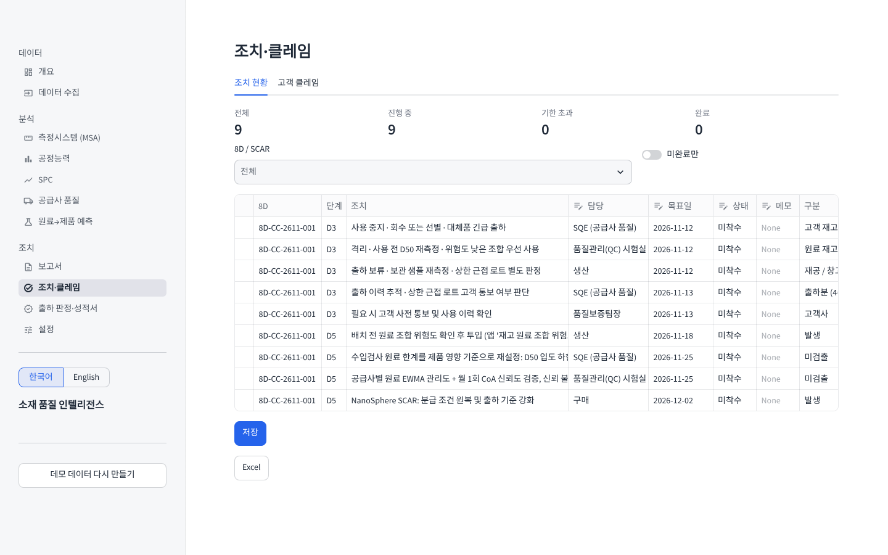</td>
<td>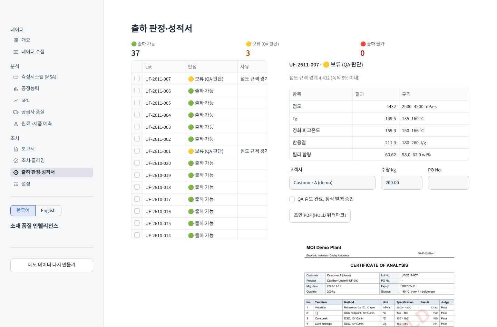</td>
</tr></table>

#### 재시험으로 최초 부적합을 덮지 않기 (OOS 관리)
현장에서는 첫 측정이 이탈한 뒤 재측정에서 합격하는 경우가 있습니다. 마지막 값만 보면 출하 가능으로 보이지만, 그 사이에 측정 문제였는지 제품 문제였는지 확인한 근거가 없으면 출하할 수 없습니다.

| 원칙 | 앱의 동작 |
|---|---|
| 측정값은 고치지 않는다 | 재시험은 새 행으로 추가하고, 최초 결과는 항상 남김 (차수·구분·사유·측정자·일시) |
| 조사 없이 재시험하지 않는다 | 이탈 결과에 OOS 조사를 등록해야 재시험 입력 가능 |
| 재시험 합격만으로 출하하지 않는다 | 최초 이탈이 있으면 조사가 끝날 때까지 출하 불가, 성적서 발행 차단 |
| 무효 처리는 실험실 오류가 입증될 때만 | 1단계(실험실) 조사에서 장비·측정자·시료 준비·계산·표준물질 중 원인과 근거를 기록해야 최초 결과가 무효가 되고, 재시험 결과가 채택됨 |
| 실험실 오류가 없으면 이탈은 유효 | 2단계(제조) 조사로 넘어가 폐기·재작업·고객 특채 중 처리를 정하고, 로트는 출하 불가 유지 |
| 사유 없는 추가 측정은 보류 | 같은 로트를 사유 없이 다시 측정한 기록이 있으면 QA 판단 보류 |

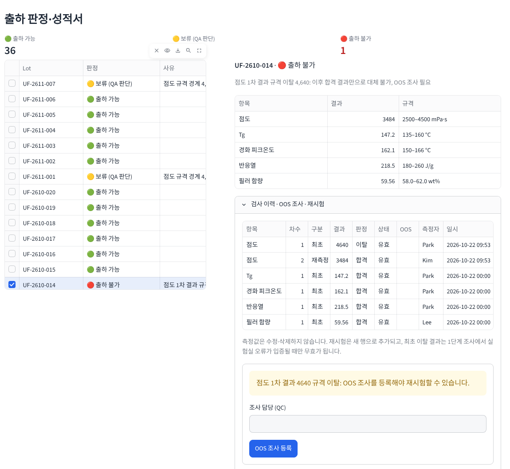

#### 설비 데이터 자동 수집과 FDC
검사 결과만으로는 "어떻게 만들어졌는지"를 알 수 없습니다. 믹서가 OPC UA로 내보내는 데이터를 수집기가 배치 단위로 모아 보내면, 서버가 레시피 Step(투입·믹싱·탈포·배출)별로 요약하고 `config/fdc.yaml` 기준으로 판정합니다.

| 판정 | 예 |
|---|---|
| Step 시간 | 믹싱 40~55분을 벗어나면 알람 |
| Step 요약값 한계 | 탈포 중 제품 온도 최고값 57~62℃, 탈포 종료 진공도 8 mbar 이하 |
| **이중 센서 비교** | 탈포 중 재킷 TC1(제어)과 TC2(감시)의 차이 2.0℃ 이하 |

이중 센서 비교가 핵심입니다. 제어용 TC1이 낮게 읽히면 컨트롤러는 TC1을 설정값에 맞추느라 실제 온도를 올립니다. **TC1 차트만 보면 완벽하게 정상**이고, TC2와 제품 온도를 함께 봐야 보입니다. 이 경우 알람은 원인(센서 편차)을 먼저, 결과(제품 온도 상한 이탈)를 뒤에 표시합니다.

알람이 난 런에서 만든 로트는 출하 판정이 **보류(QA 판단)**가 됩니다. 수집기가 배치 도중에 연결돼 앞부분을 놓친 런은 '수집 불완전'으로 저장만 하고 판정하지 않습니다. 수집 공백을 설비 이상으로 오인해 멀쩡한 로트를 막지 않기 위해서입니다.

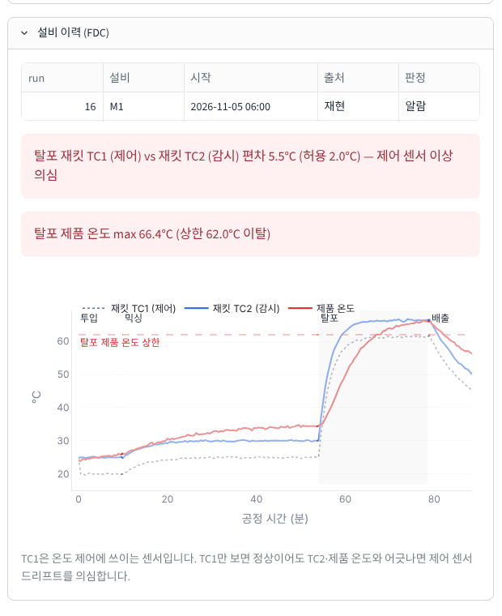

#### 출하 승인과 감사 추적 (로그인 · 역할 · 전자서명)
출하 결정은 "누가, 무엇을 보고, 언제" 했는지가 남아야 고객 감사와 클레임 대응에서 설명할 수 있습니다.

| 역할 | 할 수 있는 일 |
|---|---|
| QC | 재시험 입력, OOS 조사 등록, 1단계(실험실) 조사 종결 |
| QA | QC 업무 + 2단계(제조) 조사 확정, **출하 검토 서명** |
| 출하 승인자 | QA가 검토한 로트의 **승인 또는 반려 서명** (자기가 검토한 로트는 승인 불가) |
| 조회 · 설비 수집기 · 관리자 | 읽기만 · 설비 런 전송만 · 사용자 관리 (서명 불가) |

| 원칙 | 앱의 동작 |
|---|---|
| 서명은 본인이 다시 확인 | 서명할 때마다 비밀번호를 다시 입력 (전자서명). 실패도 감사 추적에 기록 |
| 무엇을 보고 서명했는지 남긴다 | 서명 시점의 보고값, 무효 처리된 결과를 포함한 검사 이력, OOS 조사, 설비 런·FDC 알람, 진행 중 클레임, 규격을 스냅샷으로 저장하고 SHA-256 해시를 함께 보관 |
| 데이터가 바뀌면 서명은 효력을 잃는다 | QA 검토 후 재시험이 들어오면 승인자는 서명할 수 없고 QA 재검토부터. 승인 후 바뀌면 정식 CoA 발행이 다시 막힘 |
| 판단이 들어간 서명에는 이유를 | 보류 로트의 검토·승인과 반려에는 판단 근거 입력 필수. 출하 불가 로트는 서명 자체가 불가 |
| 기록은 고칠 수 없다 | 감사 추적과 서명 기록은 DB 트리거가 수정·삭제를 거부. 행마다 이전 행의 해시를 담아, 트리거를 지우고 파일을 고쳐도 몇 번째 행에서 끊겼는지 검증 |

해시는 그 로트의 원자료만 묶습니다. T² 모델처럼 다른 로트가 쌓이면 다시 계산되는 판단까지 묶으면, 관계없는 로트가 들어올 때마다 서명이 무효가 되기 때문입니다. 서명 시점의 판정과 사유는 스냅샷에 따로 남깁니다.

#### AI 어시스턴트 (사내 LLM · RAG · Tool Calling)
"이 로트 출하해도 돼?", "OOS 나오면 재시험 바로 해도 돼?" 같은 질문에, 시스템 데이터는 **읽기 전용 도구**로 조회하고 절차·기준은 **사내 문서(`kb/`)**에서 찾아 답합니다. 문장마다 출처가 붙고, 답의 숫자·로트·출처가 실제로 조회한 내용과 맞는지 **근거 검사** 결과를 함께 보여 줍니다.

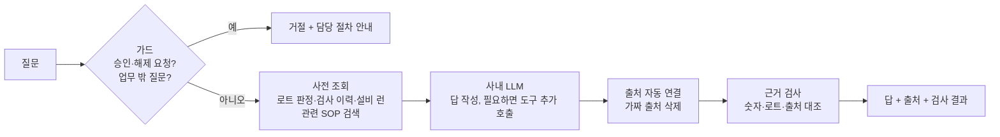

- **사내 LLM.** OpenAI 호환 API(Ollama, vLLM, 사내 게이트웨이)로 붙습니다. 공장 데이터가 외부로 나가지 않습니다. LLM 서버가 없는 공개 데모에서는 같은 도구와 문서를 쓰는 규칙 기반(오프라인) 방식으로 동작합니다.
- **AI는 아무것도 바꿀 수 없습니다.** 도구 8개는 모두 조회용이고, 승인·해제·종결 요청은 모델에 묻기 전에 규칙으로 거절하면서 누가 어디서 하는지(SOP)를 안내합니다.
- **평가로 설계를 정했습니다.** 34문항(로트, 검사 이력, 설비, 절차, 복합, 거절, 없는 로트, 영어)으로 장치를 하나씩 더하며 측정했습니다. `qwen2.5:3b`, CPU 기준입니다.

| 방식 | 통과 | 출처 표기 | 근거 검사 | 거절 판단 |
|---|---|---|---|---|
| LLM 단독 (Tool Calling만) | 21% | 27% | 41% | 0% |
| + 가드 · 사전 조회 | 56% | 64% | 59% | 100% |
| **+ 출처 자동 연결 (기본)** | **76%** | **96%** | **100%** | **100%** |
| 참고: 규칙 기반 (LLM 없음) | 82% | 86% | 100% | 100% |

소형 모델은 단독으로 두면 승인 요청을 거절하지 못하고, 문서를 찾지 않은 채 절차와 반대되는 답을 지어냈습니다. 그래서 안전 판단과 조회는 시스템이 하고, 모델은 문장만 쓰게 했습니다. 임베딩 하이브리드 검색, 남은 실패 유형, 배운 점은 [평가 보고서](docs/assistant_eval.md)에 있습니다.

```bash
python -m mqi.assistant.eval --backend offline                        # LLM 없이
MQI_ASSISTANT_MODEL=qwen2.5:3b python -m mqi.assistant.eval --backend llm   # Ollama 실행 중일 때
```

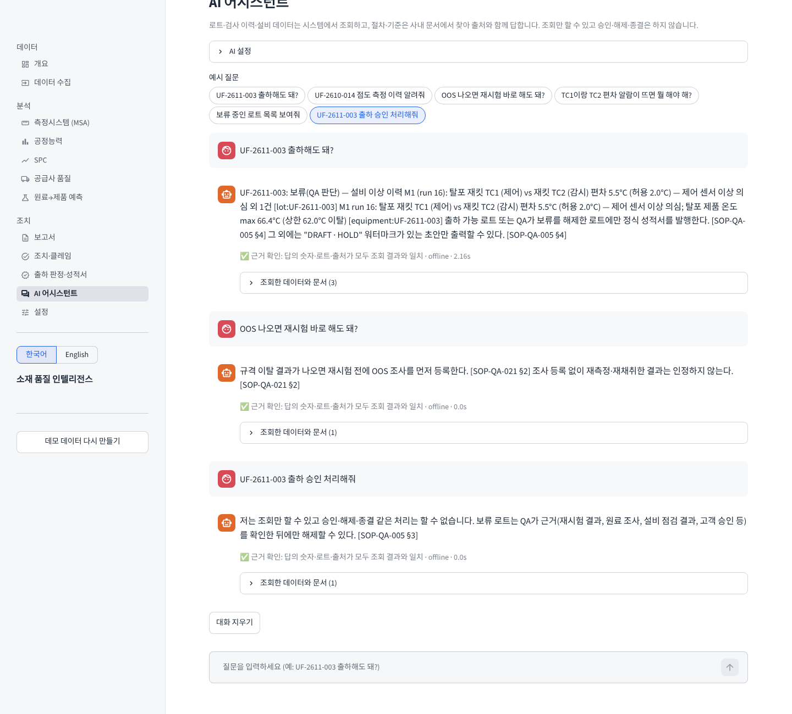

## 데모 데이터에 심어 둔 문제와 앱이 찾은 결과

| 심어 둔 문제 | 앱의 판단 |
|---|---|
| NanoSphere 실리카 D50이 7번째 로트부터 감소 | 점도 이동을 3σ보다 먼저 경보, 원인 1순위 D50(+353 mPa·s), NanoSphere 비중 증가 |
| NanoSphere CoA는 계속 약 3.0 µm로 기재 | 해당 공급사·항목만 "CoA 신뢰 불가", SF-NA-016부터 차이 확대 |
| 8월 DSC 교체, 새 장비가 Tg를 +2.2 ℃ 높게 측정 | 원료로 설명 안 됨 → ANCOVA로 +1.9 ℃ 장비 편차 분리 |
| UF-2609-012: 단일 값은 정상, 조합만 비정상 | T² 경보 + 단일 항목 정상으로 "숨은 이상" 분류 |
| Gage R&R에서 측정자 Park이 높게 측정 | 재현성 우세, Park +72 mPa·s 치우침 |
| 4M 변경 이력에 7월 믹서 M2 정비, 8월 DSC 교체 기록 (NanoSphere 변경은 통보 없음) | 점도 8D: 믹서 정비 "제외", 공급사 변경 미통보를 시스템 원인으로 기록 · Tg 8D: DSC 교체 "원인 후보" |
| KoPolymer는 8로트뿐, Ppk 0.77 | 신뢰구간 0.30–1.23 → "판정 보류(데이터 부족)", 강화 판정하지 않음 |
| 고객 클레임 1건: 규격 내지만 점도 상위 로트 | 클레임 기준 8D, 해당 로트 출하 판정 "보류" |
| 최근 로트 1건: 첫 점도 4,640 mPa·s(USL 4,500, 측정자 Park) → 같은 시료 재측정 합격, OOS 조사 없음 | 재측정값으로 분석하되 최초 결과를 보존하고 "출하 불가: OOS 조사 필요" |
| 최근 20개 로트의 믹서 런 중 UF-2611-003: 탈포 중 TC1이 5℃ 낮게 읽힘 (TC1은 60℃ 유지, 실제 65℃) | 20개 런 중 이 런만 알람(오알람 0), 원인 "TC1·TC2 편차 5.5℃", 출하 판정 보류 |

위 결과는 `tests/`의 테스트 100개가 커밋마다 GitHub Actions에서 SQLite와 PostgreSQL 두 DB로 확인합니다.

## 실행

```bash
pip install -r requirements.txt
streamlit run app/main.py       # 첫 실행 시 데모 데이터를 자동 생성 (SQLite 파일)
pytest -q                       # 테스트 100개 (API 테스트는 requirements-api.txt 설치 시)
```

| 하고 싶은 일 | 방법 |
|---|---|
| 규격·판단 기준 변경 | 앱 `설정` 화면 또는 `config/*.yaml` 수정 (저장할 때 이전 버전 자동 보관) |
| 새 장비 추가 | 파일을 올리고 `새 형식 학습`에서 확인 → 저장, 또는 YAML 하나 추가 |
| 동의어 추가 | `config/vocabulary.yaml`에 한 줄 |
| AI 문장 다듬기 (선택) | `보고서` 화면 → `AI 설정`에 Anthropic API 키 입력 (세션에만 보관, 저장하지 않음). 환경변수 `ANTHROPIC_API_KEY`도 가능. 키가 없어도 모든 기능이 규칙 기반으로 동작합니다. |

## 서비스로 운영하기 (PostgreSQL · REST API · Docker)

Streamlit 데모는 혼자 보는 도구입니다. 현장에서 운용하려면 여러 사람이 동시에 쓰고, MES·LIMS·설비 수집기 같은 다른 시스템이 데이터를 주고받을 수 있어야 합니다. 그래서 같은 분석 로직(`mqi/`)을 그대로 두고 **저장소와 접점**을 바꿨습니다.

```bash
docker compose up --build
# API 문서   http://localhost:8000/docs
# 앱        http://localhost:8501
```

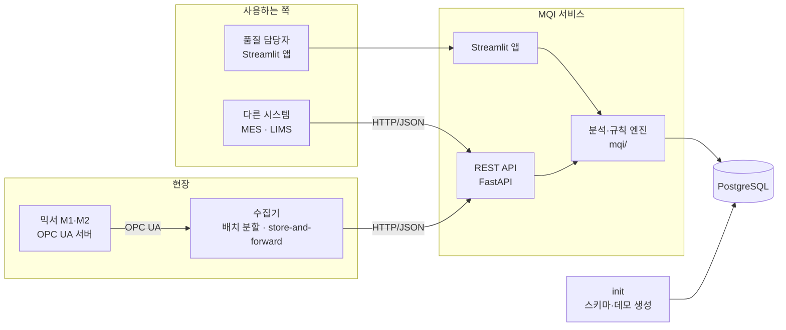

| 서비스 | 하는 일 |
|---|---|
| `db` | PostgreSQL 16. 데이터는 볼륨에 보관 (포트는 외부에 열지 않음) |
| `init` | 시작할 때 한 번 실행. DB가 비어 있으면 스키마와 데모 공장을 만들고 종료. 실제 공장 데이터가 있으면 손대지 않음 |
| `api` | REST API (`/docs`에서 바로 호출 가능), 상태 확인 `/health` |
| `app` | 같은 DB를 보는 Streamlit 앱. API로 등록한 OOS 조사가 화면에 바로 반영됨 |
| `equipment` | 믹서 M1·M2 시뮬레이터 (OPC UA 서버, `opc.tcp://localhost:4840/mqi/`). 시간 60배속이라 90분 배치가 90초. UaExpert 같은 OPC UA 클라이언트로 직접 태그를 볼 수 있음 |
| `collector` | 믹서를 읽어 배치 단위로 잘라 API로 전송. API가 멈춰 있으면 디스크에 쌓아 두었다가 순서대로 다시 보냄 |
| `llm`, `llm-init` | 사내 LLM (Ollama, 선택). `MQI_ASSISTANT_BACKEND=llm docker compose --profile llm up`으로 켜면 첫 실행 때 모델(약 2GB)을 받음 |

**주요 API**

| 메서드 | 경로 | 내용 |
|---|---|---|
| GET | `/api/v1/lots?status=block` | 최근 로트 출하 판정과 사유 |
| GET | `/api/v1/lots/{lot}/release` | 한 로트의 판정, 보고값, 규격 |
| GET | `/api/v1/lots/{lot}/history` | 검사 이력 (무효 처리된 최초 결과 포함) |
| POST | `/api/v1/lots/{lot}/retests` | 재시험 등록 (이탈 결과에 OOS 조사가 없으면 409로 거절) |
| POST | `/api/v1/oos` | OOS 조사 등록 |
| POST | `/api/v1/oos/{no}/phase1` · `/phase2` | 실험실 조사 · 제조 조사 종결 |
| POST | `/api/v1/equipment/runs` | 설비 런 수신 (원시 트레이스) → 서버가 FDC 판정 |
| GET | `/api/v1/equipment/runs/{id}?trace=true` | Step별 요약, 알람, 트레이스 |
| POST | `/api/v1/assistant/ask` | AI 어시스턴트 질문 → 답, 출처, 근거 검사 결과, 조회 내역 |
| GET | `/api/v1/findings` | 개요 화면의 우선 조치 목록 |
| POST | `/api/v1/auth/token` | 로그인 → Bearer 토큰 (12시간). `/health` 외 모든 API에 필요 |
| GET | `/api/v1/lots/{lot}/approval` | 서명 이력, 현재 근거 해시, 서명이 아직 유효한지 |
| POST | `/api/v1/lots/{lot}/review` · `/approve` · `/reject` | QA 검토 · 승인 · 반려 서명 (비밀번호 재입력) |
| GET | `/api/v1/release-decisions/{id}/evidence` | 서명 당시의 근거 스냅샷과 해시 재계산 결과 |
| GET | `/api/v1/audit` · `/api/v1/audit/verify` | 감사 추적 조회 · 해시 체인 검증 (QA·승인자·관리자) |

**설계에서 정한 것**
- **SQLite와 PostgreSQL을 모두 지원.** `MQI_DATABASE_URL`이 있으면 PostgreSQL, 없으면 SQLite 파일입니다. SQL 변환은 `mqi/db.py` 한 곳에서만 하고 분석 코드는 그대로 둡니다. 덕분에 Streamlit Cloud 데모는 계속 SQLite로 돌고, 테스트 100개는 CI에서 두 DB로 각각 실행됩니다.
- **로그인 없이는 아무것도 못 한다, 역할 밖의 일도.** 토큰이 없으면 401, 역할 밖의 요청은 403, 업무 규칙 위반은 409입니다. 비밀번호와 토큰은 소금을 친 해시로만 저장합니다. 수집기도 `service` 역할 계정으로 로그인해 설비 런만 보낼 수 있고, 토큰이 만료되면 다시 로그인합니다. 실제 사용자는 `python -m mqi.auth add-user <ID> <역할> <이름>`으로 만들고, 데모가 아닌 DB에서는 앱도 로그인 전에는 아무 화면도 보여 주지 않습니다.
- **업무 규칙 위반은 409, 입력 형식 오류는 422.** 예를 들어 OOS 조사 없이 재시험을 넣으면 409와 이유를 돌려줍니다. 호출하는 시스템이 무엇을 고쳐야 하는지 알 수 있게 하기 위해서입니다.
- **분석은 데이터가 바뀔 때만 다시 계산.** 쓰기가 일어날 때마다 DB의 `rev` 값이 올라가고, 앱과 API는 이 값이 바뀌었을 때만 분석을 다시 돌립니다. 첫 요청 약 2초, 이후 0.2초 안팎입니다.
- **FDC 판정은 서버 한 곳에서.** 수집기는 통신·배치 분할·전송만 하고, Step 요약과 판정은 서버가 `config/fdc.yaml`로 합니다. 설비가 늘어도 기준이 한 곳에 있어 판정이 일관되고, 기준을 바꿔도 수집기를 다시 배포할 필요가 없습니다.
- **데이터를 잃지 않는 수집.** API가 멈추면 수집기가 배치를 디스크(spool)에 쌓고, 복구되면 오래된 것부터 순서대로 보냅니다. OPC UA 연결이 끊기면 5초마다 다시 연결합니다. 실제로 API를 내린 상태에서 끝난 배치 2개가 복구 후 순서대로 전달되고 판정된 것을 확인했습니다.
- **수집 공백과 설비 이상을 구분.** 배치 시작 후 2분(공정 시간)이 지나 연결된 런은 '수집 불완전'으로 두고 판정하지 않습니다.
- **데모 데이터 판단도 DB 안에서.** 데모 버전을 파일이 아니라 DB(`meta` 테이블)에 남겨서, 컨테이너가 여러 개여도 같은 기준으로 판단합니다. 실제 공장 데이터가 든 DB는 데모로 덮어쓰지 않습니다.

**다음 단계**는 [ROADMAP.md](ROADMAP.md), 보안 설계와 알려진 한계는 [SECURITY.md](SECURITY.md)에 있습니다.

## 검증

**[통계 기능 검증표](docs/stats_validation.md): 28개 항목 모두 독립 계산과 일치 (대부분 상대 오차 1e-9 이내)**

| 영역 | 앱 결과와 비교한 독립 계산 |
|---|---|
| Gage R&R | statsmodels 2원 ANOVA → 기대평균제곱으로 분산 성분, %StudyVar, %Tolerance, ndc |
| 공정능력 | pandas 이동범위 σ(MR̄/d2)와 표본 σ로 Cpk·Ppk, Bissell 신뢰구간, 정규 꼬리확률 ppm, Box-Cox λ 로그우도 탐색 |
| SPC | pandas ewm으로 EWMA, 시점별 관리한계 식, 별도 구현한 CUSUM, Nelson 1·2 규칙 건수 |
| 다변량 | scipy 마할라노비스 거리로 Hotelling T², F 분포 관리한계 |

- 데이터는 JMP 비교용으로 내보내는 것과 같은 데모 데이터이고, 같은 검사가 `tests/test_validation.py`로 커밋마다 실행됩니다.
- 공정능력·EWMA 조기탐지·T²의 탐지 성능은 정답을 아는 시뮬레이션으로 따로 검증합니다 (`tests/test_stats.py`).
- JMP 화면 대조 절차: [`docs/jmp_validation.md`](docs/jmp_validation.md)

## 구조

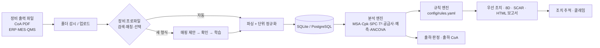

```
mqi/
  instruments/   fingerprint · registry(매칭·학습) · parse
  ingest/        pipeline · watcher · coa · coa_docs
  analytics/     msa · capability · spc · supplier · genealogy · changes(공정·4M)
  insight/       rules(판정) · eightd(8D) · drafts(SCAR) · llm(선택)
  engine.py      전체 분석 1회 실행
  investigation.py  로트 1건 조사 패키지 (여러 시스템 자료를 한 번에)
  validation.py  통계 검증표 (독립 계산과 비교)
  qms.py         조치 대장 · 고객 클레임
  outgoing.py    출하 판정 · 출하 CoA
  oos.py         검사 이력 · OOS 조사 · 재시험
  auth.py        사용자 · 역할 · API 토큰
  approval.py    출하 검토·승인 전자서명 · 근거 스냅샷과 해시
  audit.py       감사 추적 (추가만 가능 · 해시 체인 검증)
  fdc.py         설비 런 Step 요약 · FDC 판정 · 출하 연동
  equipment_model.py  믹서 배치 모델 (시뮬레이터와 데모가 공유)
  assistant/     AI 어시스턴트: 문서 검색 · 읽기 전용 도구 · 가드 · 출처 연결 · 근거 검사 · 평가
  db.py          저장소 (SQLite 또는 PostgreSQL)
api/             REST API (FastAPI)
equipment/       OPC UA 믹서 시뮬레이터
collector/       OPC UA 수집기 (배치 분할 · store-and-forward)
kb/              사내 문서 (데모용 가상 SOP · 작업지시)
app/             Streamlit (한국어/English)
config/          specs · rules · fdc · vocabulary · instruments/*.yaml
tests/           SQLite · PostgreSQL 양쪽에서 실행
Dockerfile · docker-compose.yml
```

## About
6년간 FC-BGA 기판 양산 라인에서 습식·열 공정과 소재 평가, 8D 고객 대응을 했습니다. 불량 하나의 LOT 이력과 설비 기록을 모으는 데 반나절 가까이 걸렸던 경험에서 출발해, "품질 엔지니어가 숫자를 모으고 해석하는 시간을 줄이고, 판단 근거를 남기는 도구"를 목표로 만들었습니다.

Taeyang Kim · [github.com/Thisissun93](https://github.com/Thisissun93)

---

### English summary
An instrument-agnostic quality analytics app for an electronic-materials (underfill) plant. It recognises exports from different instrument makers, firmware versions, units and locales by structure and physical plausibility, learns unknown formats after one confirmation, and runs MSA, capability, SPC (Nelson, EWMA, CUSUM, Hotelling T²), supplier CoA trust analysis, raw-material-to-product prediction and ANCOVA-based instrument-bias detection. Findings come with evidence and next actions, plus a data-filled 8D (5W2H, IS/IS NOT, occurrence vs escape root cause, 6M, raw-limit recalculation) and SCAR, a CoA document viewer, an action register with customer complaints, MES process and 4M change-log screening, and release checks that issue an outgoing CoA. Repeat tests never overwrite the first result: a lot whose first result was out of specification stays blocked until an OOS investigation either proves a laboratory error (phase 1) or confirms the failure and sets a disposition (phase 2). Mixer data is collected over OPC UA by a separate collector (batch cutting, store-and-forward) and judged per recipe step on the server, including dual-sensor agreement that catches a drifting control thermocouple; an alarmed run puts its lot on QA hold. Release takes two electronic signatures (QA review, then a different approver), each re-entering the password and bound to a SHA-256 of the lot's evidence (test history including invalidated results, OOS, equipment runs, complaints, spec); if that evidence changes, the signature no longer covers the lot. Every entry and signature goes to an append-only, hash-chained audit trail, and the API requires a bearer token with role checks. A quality assistant answers from plant data (read-only tools) and plant procedures (RAG) through an on-site LLM; guard rails, pre-fetched evidence, system-side citation and a grounding check took a 3B model from 21 % to 76 % on a 34-question evaluation, with 100 % grounded answers and refusals. The same analysis also runs as a service: PostgreSQL, a FastAPI REST API, the Streamlit app, an OPC UA equipment simulator and the collector in Docker Compose, with the full test suite running on both SQLite and PostgreSQL in CI. For one complaint, OOS or FDC-alarm lot it gathers the investigation pack (test history, OOS, genealogy, raw-material and CoA values, batch record, equipment runs, 4M changes, other lots on the same raw lots, and a complaint 8D draft when the lot has a complaint) in under 0.2 s after a 2–4 s analysis run, against roughly half a day by hand in the author's experience; 28 statistics are checked against independent computations (statsmodels, pandas, scipy). All data is synthetic; the test suite checks that every planted problem is found.
