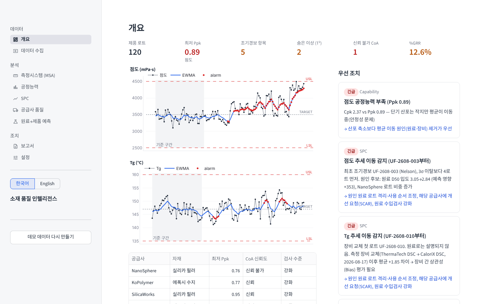
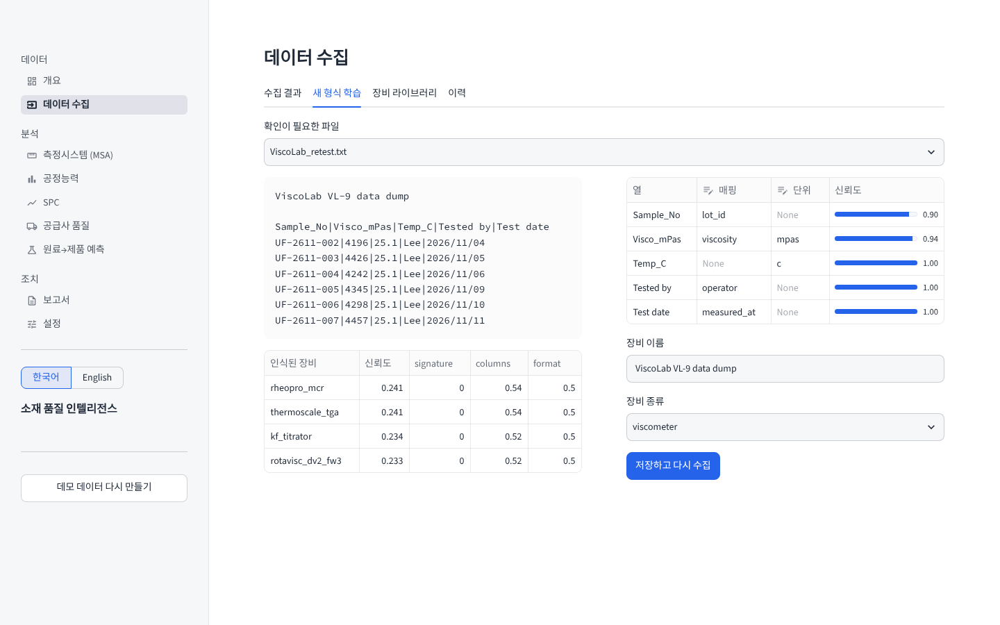
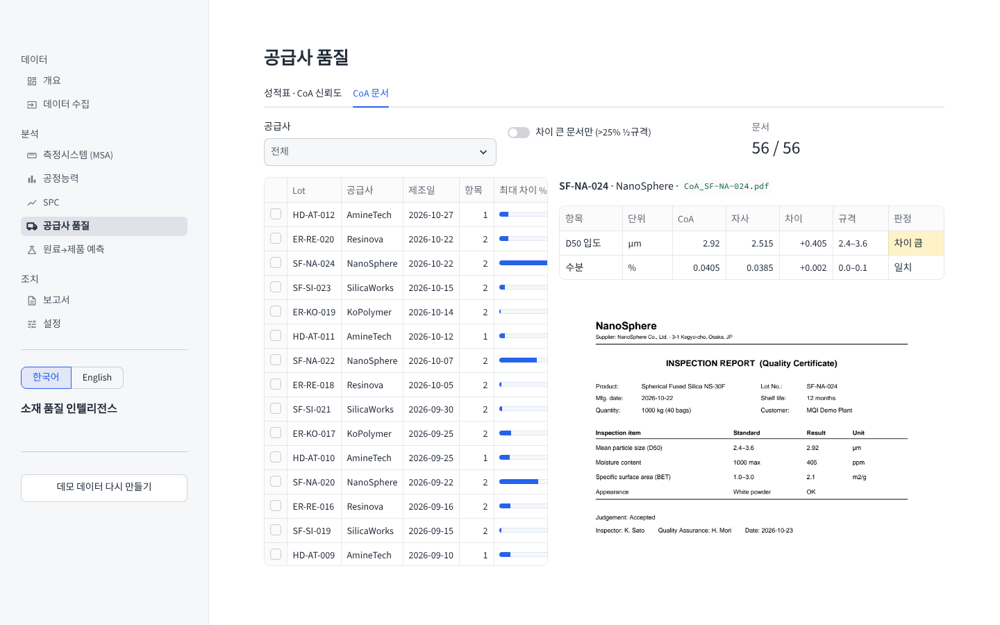
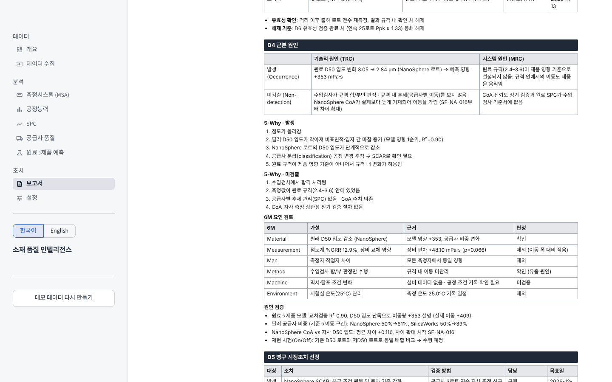
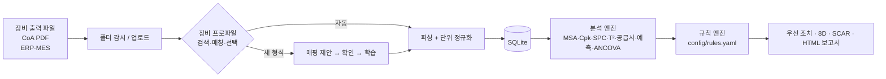

# Material Quality Intelligence

반도체 패키징 소재(언더필·에폭시 접착제) 공장의 품질 데이터를 **장비 제조사·펌웨어·단위·언어에 상관없이 자동으로 모으고**, MSA·공정능력·SPC·공급사 품질·원료→제품 예측까지 한 번에 분석해 **조치(8D·SCAR)까지 만들어 주는** Streamlit 앱입니다.

https://materialqualityintelligence-dknsnjemfstfko4zluzplu.streamlit.app/

> 모든 데이터는 합성 데이터입니다. 실제 공장처럼 여러 장비 형식과 숨은 문제를 일부러 심어 두었고, 앱이 그것을 스스로 찾아내는지 테스트로 검증합니다.



## 무엇이 다른가

| 일반적인 품질 대시보드 | 이 프로젝트 |
|---|---|
| 정해진 CSV 형식만 읽음 | 처음 보는 장비 파일도 **구조·열 이름·값의 물리적 타당성**으로 판별. 모르는 형식은 한 번 확인하면 학습 |
| 3σ 관리한계 이탈을 표시 | **EWMA·CUSUM·Nelson 8규칙**으로 3σ보다 먼저 경보, 다변량 **T²**로 "단일 값은 정상인데 조합이 이상한" 로트 탐지 |
| 이상을 보여 주고 끝 | **MES 원료 이력(genealogy)**을 따라가 어떤 원료·공급사가 원인인지 수치로 제시 |
| CoA를 그대로 신뢰 | **CoA vs 자사 측정**을 비교해 공급사 성적서의 신뢰도와 "언제부터 어긋났는지" 판정 |
| 장비 교체 영향을 공정 변화로 오인 | **공분산분석(ANCOVA)**으로 원료 영향을 뺀 순수 장비 편차만 분리 |
| 보고서는 사람이 작성 | 데이터로 채운 **표준 8D(D0–D8)·SCAR** 자동 작성: 5W2H·IS/IS NOT, 발생/유출 원인 분리, 6M 검증, 원료 한계 재계산 (한/영, A4·Excel) |
| 결과만 보여 줌 | 재고 원료 조합별 **다음 배치 이탈 확률**을 예측해 사용할 조합을 추천 |

## 핵심 기능

### 1. 장비 자동 인식 (Searching → Matching → Choice)
같은 점도라도 장비마다 출력이 다릅니다. `cP`/`mPa·s`/`Pa·s`, 콤마/세미콜론/탭, 소수점 콤마(유럽 로케일), 켈빈, ppm, 펌웨어별 열 이름, 한 줄에 한 값(long) 또는 `키: 값` 보고서.

1. **Search**: 등록된 모든 장비 프로파일(`config/instruments/*.yaml`)을 파일에 대입합니다.
2. **Match**: 구조 점수(서명 문구·열 이름 유사도·구분자/소수점)와 내용 점수(변환한 값이 물리적으로 말이 되는지)를 합쳐 신뢰도를 냅니다. DSC 파일을 점도계로 잘못 읽으면 내용 점수에서 떨어집니다.
3. **Choice**: 신뢰도와 2순위와의 차이가 충분하면 자동 저장, 애매하면 확인 요청, 처음 보는 형식이면 `config/vocabulary.yaml`(다국어 동의어)로 매핑 초안을 만들어 보여 줍니다. 한 번 확인하면 프로파일로 저장되어 다음부터 자동 인식됩니다.



공유 폴더를 감시하면 장비가 파일을 저장하는 즉시 수집됩니다.

```bash
python -m mqi.ingest.watcher "D:/LabShare/Exports"
```

공급사 CoA PDF는 표 형식, 점선 형식 등 양식이 달라도 같은 동의어 사전으로 읽습니다. `공급사 품질 → CoA 문서`에서 원본 PDF와 추출값·자사 측정·규격을 나란히 보고, 차이가 큰 성적서만 골라 볼 수 있습니다.



### 2. 분석
| 영역 | 내용 |
|---|---|
| MSA | 교차 Gage R&R (2원 ANOVA, AIAG), %StudyVar·%Tolerance·ndc, 치우친 측정자 식별 |
| 공정능력 | Cp/Cpk(MR̄/d2), Pp/Ppk, Cpk 신뢰구간, 비정규 시 Box-Cox, 이동 Ppk |
| SPC | I 관리도 + Nelson 1–8, EWMA, CUSUM, 방법별 첫 경보 시점 비교, Hotelling T² + 항목별 기여도 |
| 공급사 | CoA 신뢰도(짝 t검정·Bland-Altman·차이 추세), 공급사 성적표, 검사 수준(강화/보통/Skip-lot) 추천 |
| 원료→제품 | 로트 이력 결합 → Ridge/GBM 교차검증 선택 → 원인 기여도, 다음 배치 시뮬레이터, 재고 조합 위험도 순위 |
| 측정 장비 편차 | ANCOVA로 원료 영향을 통제한 장비 교체 Bias |

### 3. 조치
판단 기준은 `config/rules.yaml`에만 있습니다. 결과는 근거·조치가 붙은 우선순위 목록, 8D, 공급사 SCAR, HTML 보고서로 나옵니다.

8D는 Ford G8D / VDA 8D 구성을 따릅니다.

| 단계 | 자동으로 채우는 내용 |
|---|---|
| D0–D2 | 증상·ERA, 기능별 팀, 원인을 가정하지 않은 문제 정의, 5W2H, 데이터 기반 IS / IS NOT (물성·공급사·시점·측정자) |
| D3 | 원료 재고·재공·출하분·고객 단위 봉쇄 수량, 담당, 목표일, 해제 기준 |
| D4 | **발생 원인**과 **유출(미검출) 원인**을 기술적(TRC)·시스템(MRC)으로 분리, 5-Why, 6M 판정, 검증 근거 |
| D5–D6 | 두 원인 각각의 영구 대책과 검증 방법. 원료 수입 한계는 모델로 다시 계산 (예: D50 하한 2.4 → 2.58 µm) |
| D7–D8 | PFMEA·관리계획서 변경안, 표준 개정, 수평 전개, 교훈, 종결 체크리스트 |

원인이 측정 장비로 판정되면(예: DSC 교체) 봉쇄·원인·대책이 측정 시스템 기준으로 바뀝니다. 편집 후 A4 HTML(브라우저에서 PDF 인쇄), Excel 양식, Markdown으로 내려받습니다.



## 데모 데이터에 심어 둔 문제와 앱이 찾은 결과

| 심어 둔 문제 | 앱의 판단 |
|---|---|
| NanoSphere 실리카 D50이 7번째 로트부터 감소 | 점도 이동을 3σ보다 먼저 경보, 원인 1순위 D50(+353 mPa·s), NanoSphere 비중 증가 |
| NanoSphere CoA는 계속 약 3.0 µm로 기재 | 해당 공급사·항목만 "CoA 신뢰 불가", SF-NA-016부터 차이 확대 |
| 8월 DSC 교체, 새 장비가 Tg를 +2.2 ℃ 높게 측정 | 원료로 설명 안 됨 → ANCOVA로 +1.9 ℃ 장비 편차 분리 |
| UF-2609-012: 단일 값은 정상, 조합만 비정상 | T² 경보 + 단일 항목 정상으로 "숨은 이상" 분류 |
| Gage R&R에서 측정자 Park이 높게 측정 | 재현성 우세, Park +72 mPa·s 치우침 |

위 내용은 `tests/test_findings.py`가 매번 확인합니다.

## 실행

```bash
pip install -r requirements.txt
streamlit run app/main.py       # 첫 실행 시 데모 데이터를 자동 생성
pytest -q                       # 29개 테스트
```

| 하고 싶은 일 | 방법 |
|---|---|
| 규격·판단 기준 변경 | 앱 `설정` 화면 또는 `config/*.yaml` 수정 (저장 시 이전 버전 자동 보관) |
| 새 장비 추가 | 파일을 올리고 `새 형식 학습`에서 확인 → 저장, 또는 YAML 하나 추가 |
| 동의어 추가 | `config/vocabulary.yaml`에 한 줄 |
| AI 문장 다듬기 (선택) | `보고서` 화면 → `AI 설정`에 Anthropic API 키 입력 (세션에만 보관, 저장 안 함). 또는 환경변수 `ANTHROPIC_API_KEY`. Claude 구독과 별개인 개발자용 키로 사용량만큼 과금되며, 없어도 모든 기능이 규칙 기반으로 동작합니다. |

## 검증
- Gage R&R 제곱합은 `statsmodels` ANOVA와 1e-9 수준까지 일치 (`tests/test_stats.py`)
- 공정능력·EWMA 조기탐지·T²는 정답을 아는 시뮬레이션으로 검증
- JMP 비교: [`docs/jmp_validation.md`](docs/jmp_validation.md)

## 구조



```
mqi/
  instruments/   fingerprint · registry(매칭·학습) · parse
  ingest/        pipeline · watcher · coa · coa_docs
  analytics/     msa · capability · spc · supplier · genealogy
  insight/       rules(판정) · eightd(8D) · drafts(SCAR) · llm(선택)
  engine.py      전체 분석 1회 실행
app/             Streamlit (한국어/English)
config/          specs · rules · vocabulary · instruments/*.yaml
tests/
```

## About
6년간 FC-BGA 기판 양산 라인에서 습식·열 공정과 소재 평가, 8D 고객 대응을 했습니다. 불량 하나의 LOT 이력과 설비 기록을 모으는 데 반나절 가까이 걸렸던 경험에서 출발해, "품질 엔지니어가 숫자를 모으고 해석하는 시간을 줄이고, 판단 근거를 남기는 도구"를 목표로 만들었습니다.

Taeyang Kim · [github.com/Thisissun93](https://github.com/Thisissun93)

---

### English summary
An instrument-agnostic quality analytics app for an electronic-materials (underfill) plant. It recognises exports from different instrument makers, firmware versions, units and locales by structure and physical plausibility, learns unknown formats after one confirmation, and runs MSA, capability, SPC (Nelson, EWMA, CUSUM, Hotelling T²), supplier CoA trust analysis, raw-material-to-product prediction and ANCOVA-based instrument-bias detection. Findings come with evidence and next actions, plus a data-filled 8D (5W2H, IS/IS NOT, occurrence vs escape root cause, 6M, raw-limit recalculation) and SCAR, and a CoA document viewer. All data is synthetic; the test suite checks that every planted problem is found.
