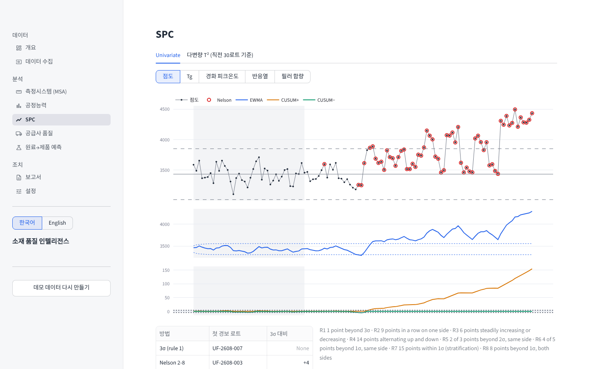
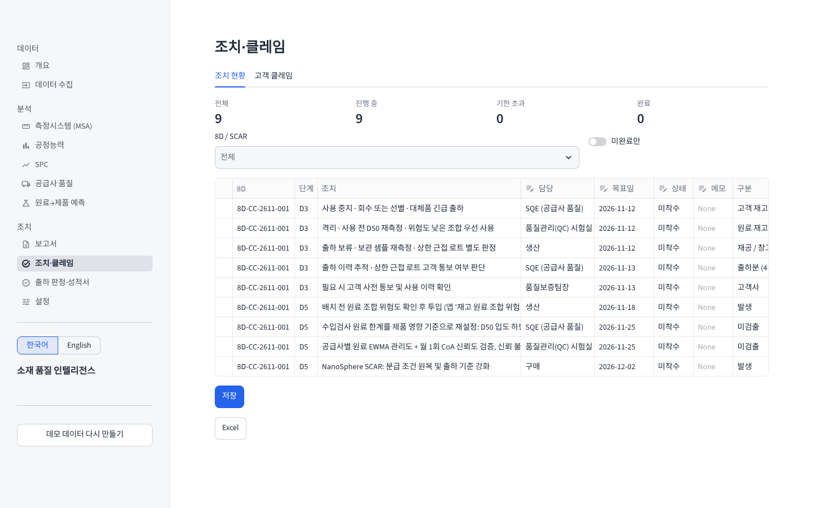
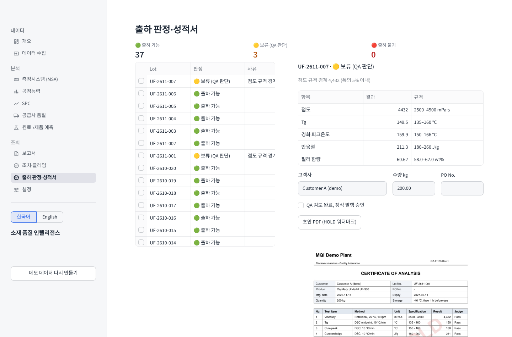
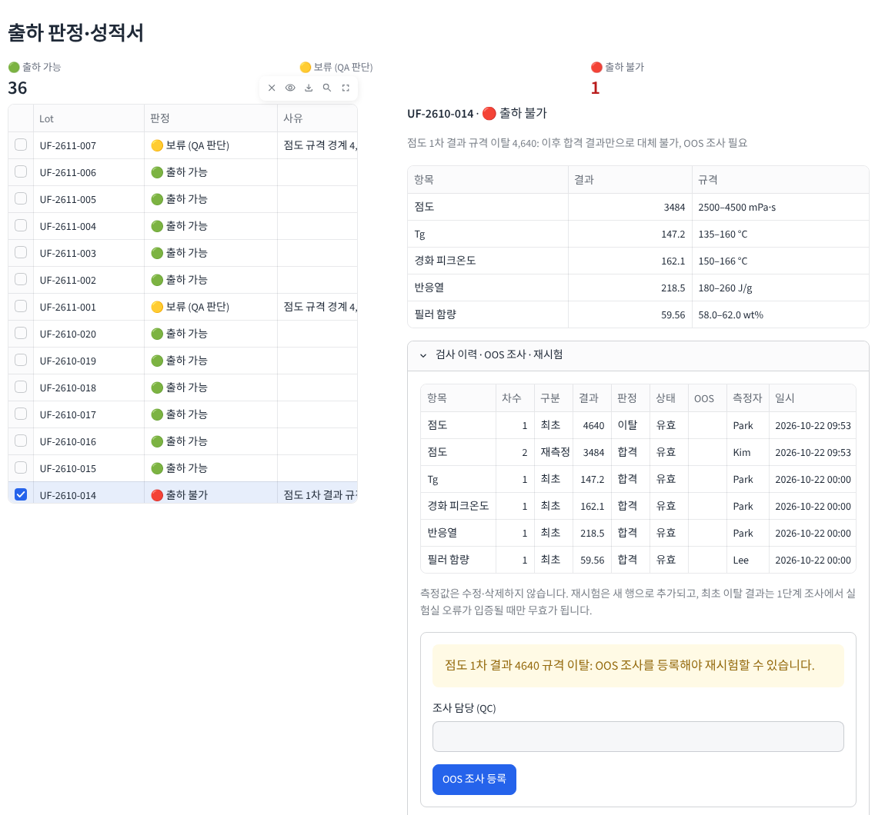
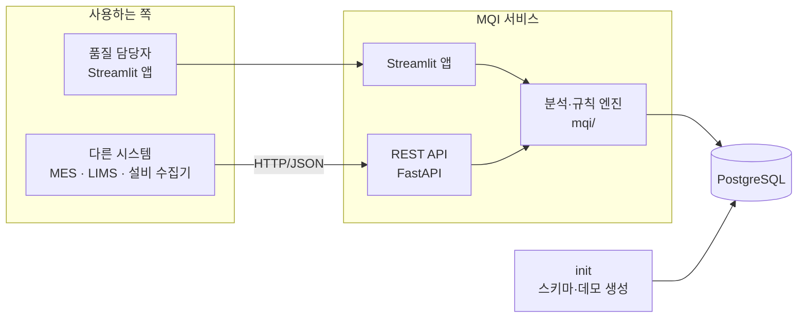
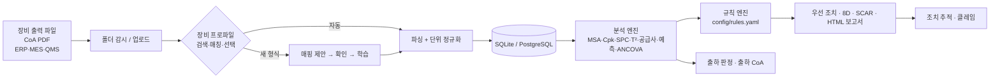

# Material Quality Intelligence

[](https://github.com/Thisissun93/Material_Quality_Intelligence/actions/workflows/tests.yml)


반도체 패키징 소재(언더필·에폭시 접착제) 공장의 품질 데이터를 **장비 제조사·펌웨어·단위·언어에 상관없이 자동으로 모으고**, MSA·공정능력·SPC·공급사 품질·원료→제품 예측을 한 번에 분석해 **8D·SCAR·출하 성적서까지 만들어 주는** Streamlit 앱입니다. 재시험 합격으로 최초 부적합을 덮지 못하도록 **OOS 조사 이력**까지 관리합니다.

**▶ [데모 앱 열기](https://materialqualityintelligence-dknsnjemfstfko4zluzplu.streamlit.app/)** (설치 없이 브라우저에서 바로 실행, 한국어/English)

> 모든 데이터는 합성 데이터입니다. 실제 공장처럼 여러 장비 형식과 숨은 문제를 일부러 심어 두었고, 앱이 그 문제를 스스로 찾아내는지 테스트로 검증합니다.


**목차** · [무엇이 다른가](#무엇이-다른가) · [3분 둘러보기](#3분-둘러보기) · [핵심 기능](#핵심-기능) · [심어 둔 문제와 결과](#데모-데이터에-심어-둔-문제와-앱이-찾은-결과) · [실행](#실행) · [서비스로 운영하기](#서비스로-운영하기-postgresql--rest-api--docker) · [검증](#검증) · [구조](#구조) · [English](#english-summary)

## 무엇이 다른가

| 일반적인 품질 대시보드 | 이 프로젝트 |
|---|---|
| 정해진 CSV 형식만 읽음 | 처음 보는 장비 파일도 **구조·열 이름·값의 물리적 타당성**으로 판별. 모르는 형식은 한 번 확인하면 학습 |
| 3σ 관리한계 이탈을 표시 | **EWMA·CUSUM·Nelson 8규칙**으로 3σ보다 먼저 경보, 다변량 **T²**로 "단일 값은 정상인데 조합이 이상한" 로트 탐지 |
| 이상을 보여 주고 끝 | **MES 원료 이력(genealogy)**을 따라가 어떤 원료·공급사가 원인인지 수치로 제시 |
| CoA를 그대로 신뢰 | **CoA vs 자사 측정**을 비교해 공급사 성적서의 신뢰도와 "언제부터 어긋났는지" 판정 |
| 장비 교체 영향을 공정 변화로 오인 | **공분산분석(ANCOVA)**으로 원료 영향을 뺀 순수 장비 편차만 분리 |
| 보고서는 사람이 작성 | 데이터로 채운 **표준 8D(D0–D8)·SCAR** 자동 작성: 5W2H·IS/IS NOT, 발생/유출 원인 분리, 6M 검증, 원료 한계 재계산 (한/영, A4·Excel) |
| 결과만 보여 줌 | 재고 원료 조합별 **다음 배치 이탈 확률**을 예측해 사용할 조합을 추천 |
| 조치는 엑셀로 따로 관리 | 8D·SCAR 조치를 **담당·기한·상태**로 추적하고, 상태가 8D D5·D6에 자동 반영 |
| 재시험 합격이면 그대로 출하 | 최초 결과를 지우지 않고 보존, **OOS 조사**(1단계 실험실 → 2단계 제조)가 끝나기 전에는 출하·성적서 발행 차단 |
| 출하 성적서는 수기 작성 | 출하 판정(가능/보류/불가)을 통과한 로트만 **출하 CoA PDF** 발행 |

## 3분 둘러보기

| 순서 | 화면 | 볼 것 |
|---|---|---|
| 1 | 개요 | 우선 조치 목록: 점도 이동, Tg 장비 편차, CoA 신뢰 불가, 고객 클레임, 최초 결과 이탈 로트 |
| 2 | SPC | EWMA가 3σ보다 4로트 먼저 경보, 차트 위 4M 변경점 |
| 3 | 공급사 품질 → CoA 문서 | NanoSphere 성적서 원본과 자사 측정의 차이 |
| 4 | 원료→제품 예측 | 원인 기여도 1순위 D50, 재고 원료 조합별 이탈 확률 |
| 5 | 보고서 | 데이터로 채운 8D (출발점을 고객 클레임으로 바꿔 보기) → "조치 등록" |
| 6 | 조치·클레임 / 출하 판정·성적서 | 등록된 조치의 상태 관리, 보류 로트와 출하 CoA 발행 |
| 7 | 출하 판정·성적서 → **UF-2610-014** | 첫 점도 4,640(이탈) → 재측정 3,484(합격)인데도 출하 불가. `검사 이력 · OOS 조사 · 재시험`에서 조사 등록 → 1단계 종결까지 직접 진행 |

## 핵심 기능

### 1. 장비 자동 인식 (Searching → Matching → Choice)
같은 점도라도 장비마다 출력이 다릅니다. 단위(`cP`/`mPa·s`/`Pa·s`), 구분자(콤마/세미콜론/탭), 소수점 콤마(유럽 로케일), 켈빈·ppm 표기, 펌웨어별 열 이름, 한 줄에 한 값(long) 형식이나 `키: 값` 보고서 형식까지 제각각입니다.

1. **Search**: 등록된 모든 장비 프로파일(`config/instruments/*.yaml`)을 파일에 대입합니다.
2. **Match**: 구조 점수(서명 문구·열 이름 유사도·구분자/소수점)와 내용 점수(변환한 값이 물리적으로 말이 되는지)를 합쳐 신뢰도를 냅니다. DSC 파일을 점도계로 잘못 읽으면 내용 점수에서 떨어집니다.
3. **Choice**: 신뢰도와 2순위와의 차이가 충분하면 자동 저장, 애매하면 확인 요청, 처음 보는 형식이면 `config/vocabulary.yaml`(다국어 동의어)로 매핑 초안을 만들어 보여 줍니다. 한 번 확인하면 프로파일로 저장되어 다음부터 자동 인식됩니다.


공유 폴더를 감시하면 장비가 파일을 저장하는 즉시 수집합니다.

```bash
python -m mqi.ingest.watcher "D:/LabShare/Exports"
```

공급사 CoA PDF는 표 형식, 검사 성적서 형식 등 양식이 달라도 같은 동의어 사전으로 읽습니다. `공급사 품질 → CoA 문서`에서 원본 PDF와 추출값·자사 측정값·규격을 나란히 보고, 차이가 큰 성적서만 골라 볼 수 있습니다.


### 2. 분석
| 영역 | 내용 |
|---|---|
| MSA | 교차 Gage R&R (2원 ANOVA, AIAG), %StudyVar·%Tolerance·ndc, 치우친 측정자 식별 |
| 공정능력 | Cp/Cpk(MR̄/d2), Pp/Ppk, Cpk 신뢰구간, 비정규 시 Box-Cox, 이동 Ppk |
| SPC | I 관리도 + Nelson 1–8, EWMA, CUSUM, 방법별 첫 경보 시점 비교, Hotelling T² + 항목별 기여도 |
| 공급사 | CoA 신뢰도(짝 t검정·Bland-Altman·차이 추세), 공급사 성적표(Ppk 95% 신뢰구간), 검사 수준(강화/보통/Skip-lot/판정 보류) 추천. 로트가 적으면 신뢰구간으로 판단해 성급한 강화 판정을 막음 |
| 원료→제품 | 로트 이력 결합 → Ridge/GBM 교차검증 선택 → 원인 기여도, 다음 배치 시뮬레이터, 재고 조합 위험도 순위 |
| 측정 장비 편차 | ANCOVA로 원료 영향을 통제한 장비 교체 Bias |
| 공정 조건 | MES 배치 기록(믹서·진공도·탈포 온도·믹싱 시간·배치 크기)을 원료로 설명 안 되는 편차와 비교 → 8D 6M의 Machine·Method를 데이터로 판정 |
| 4M 변경점 | QMS 변경 이력을 SPC 차트에 표시하고, 이동 시작 전후 변경점마다 원료 보정 후 단차를 검정. 원인 공급사의 변경이 이력에 없으면 "사전 통보 없음"을 시스템 원인으로 기록 |



### 3. 조치
판단 기준은 `config/rules.yaml` 한 곳에서 관리합니다. 결과는 근거와 조치가 붙은 우선순위 목록, 8D, 공급사 SCAR, HTML 보고서로 나옵니다.

8D는 Ford G8D / VDA 8D 구성을 따릅니다.

| 단계 | 자동으로 채우는 내용 |
|---|---|
| D0–D2 | 증상·ERA, 기능별 팀, 원인을 가정하지 않은 문제 정의, 5W2H, 데이터 기반 IS / IS NOT (물성·공급사·시점·측정자) |
| D3 | 원료 재고·재공·출하분·고객 단위 봉쇄 수량, 담당, 목표일, 해제 기준 |
| D4 | **발생 원인**과 **유출(미검출) 원인**을 기술적(TRC)·시스템(MRC)으로 분리, 5-Why, 6M 판정, 검증 근거 |
| D5–D6 | 두 원인 각각의 영구 대책과 검증 방법. 원료 수입 한계는 모델로 다시 계산 (예: D50 하한 2.4 → 2.58 µm) |
| D7–D8 | PFMEA·관리계획서 변경안, 표준 개정, 수평 전개, 교훈, 종결 체크리스트 |

원인이 측정 장비로 판정되면(예: DSC 교체) 봉쇄·원인·대책이 측정 시스템 기준으로 바뀝니다. 고객 클레임을 출발점으로 고르면 고객 재고 봉쇄와 24시간 회신 기한이 들어간 클레임 8D가 됩니다. 앱에서 편집한 뒤 A4 HTML(브라우저에서 PDF로 인쇄), Excel 양식, Markdown으로 내려받습니다.


| 화면 | 내용 |
|---|---|
| 조치·클레임 | 8D에서 "조치 등록"을 누르면 D3·D5 조치가 등록됩니다. 담당·기한·상태·메모를 표에서 바로 고치고, 기한이 지나면 표시되며, Excel로 내보낼 수 있습니다. 클레임을 등록하면 클레임 기준 8D로 바로 이동합니다. |
| 출하 판정·성적서 | 최근 로트를 출하 가능 / 보류(규격 경계 5% 이내, T² 이상, 진행 중 클레임) / 불가(규격 이탈·미측정)로 판정합니다. 가능 로트는 출하 CoA PDF를 발행하고, 보류 로트는 QA 승인 전까지 HOLD 워터마크 초안만 나옵니다. |

<table><tr>
<td></td>
<td></td>
</tr></table>

#### 재시험으로 최초 부적합을 덮지 않기 (OOS 관리)
현장에서는 첫 측정이 이탈한 뒤 재측정에서 합격하는 경우가 있습니다. 마지막 값만 보면 출하 가능으로 보이지만, 그 사이에 측정 문제였는지 제품 문제였는지 확인한 근거가 없으면 출하할 수 없습니다.

| 원칙 | 앱의 동작 |
|---|---|
| 측정값은 고치지 않는다 | 재시험은 새 행으로 추가하고, 최초 결과는 항상 남김 (차수·구분·사유·측정자·일시) |
| 조사 없이 재시험하지 않는다 | 이탈 결과에 OOS 조사를 등록해야 재시험 입력 가능 |
| 재시험 합격만으로 출하하지 않는다 | 최초 이탈이 있으면 조사가 끝날 때까지 출하 불가, 성적서 발행 차단 |
| 무효 처리는 실험실 오류가 입증될 때만 | 1단계(실험실) 조사에서 장비·측정자·시료 준비·계산·표준물질 중 원인과 근거를 기록해야 최초 결과가 무효가 되고, 재시험 결과가 채택됨 |
| 실험실 오류가 없으면 이탈은 유효 | 2단계(제조) 조사로 넘어가 폐기·재작업·고객 특채 중 처리를 정하고, 로트는 출하 불가 유지 |
| 사유 없는 추가 측정은 보류 | 같은 로트를 사유 없이 다시 측정한 기록이 있으면 QA 판단 보류 |



## 데모 데이터에 심어 둔 문제와 앱이 찾은 결과

| 심어 둔 문제 | 앱의 판단 |
|---|---|
| NanoSphere 실리카 D50이 7번째 로트부터 감소 | 점도 이동을 3σ보다 먼저 경보, 원인 1순위 D50(+353 mPa·s), NanoSphere 비중 증가 |
| NanoSphere CoA는 계속 약 3.0 µm로 기재 | 해당 공급사·항목만 "CoA 신뢰 불가", SF-NA-016부터 차이 확대 |
| 8월 DSC 교체, 새 장비가 Tg를 +2.2 ℃ 높게 측정 | 원료로 설명 안 됨 → ANCOVA로 +1.9 ℃ 장비 편차 분리 |
| UF-2609-012: 단일 값은 정상, 조합만 비정상 | T² 경보 + 단일 항목 정상으로 "숨은 이상" 분류 |
| Gage R&R에서 측정자 Park이 높게 측정 | 재현성 우세, Park +72 mPa·s 치우침 |
| 4M 변경 이력에 7월 믹서 M2 정비, 8월 DSC 교체 기록 (NanoSphere 변경은 통보 없음) | 점도 8D: 믹서 정비 "제외", 공급사 변경 미통보를 시스템 원인으로 기록 · Tg 8D: DSC 교체 "원인 후보" |
| KoPolymer는 8로트뿐, Ppk 0.77 | 신뢰구간 0.30–1.23 → "판정 보류(데이터 부족)", 강화 판정하지 않음 |
| 고객 클레임 1건: 규격 내지만 점도 상위 로트 | 클레임 기준 8D, 해당 로트 출하 판정 "보류" |
| 최근 로트 1건: 첫 점도 4,640 mPa·s(USL 4,500, 측정자 Park) → 같은 시료 재측정 합격, OOS 조사 없음 | 재측정값으로 분석하되 최초 결과를 보존하고 "출하 불가: OOS 조사 필요" |

위 결과는 `tests/`의 테스트 50개가 커밋마다 GitHub Actions에서 SQLite와 PostgreSQL 두 DB로 확인합니다.

## 실행

```bash
pip install -r requirements.txt
streamlit run app/main.py       # 첫 실행 시 데모 데이터를 자동 생성 (SQLite 파일)
pytest -q                       # 테스트 50개 (API 테스트는 requirements-api.txt 설치 시)
```

| 하고 싶은 일 | 방법 |
|---|---|
| 규격·판단 기준 변경 | 앱 `설정` 화면 또는 `config/*.yaml` 수정 (저장할 때 이전 버전 자동 보관) |
| 새 장비 추가 | 파일을 올리고 `새 형식 학습`에서 확인 → 저장, 또는 YAML 하나 추가 |
| 동의어 추가 | `config/vocabulary.yaml`에 한 줄 |
| AI 문장 다듬기 (선택) | `보고서` 화면 → `AI 설정`에 Anthropic API 키 입력 (세션에만 보관, 저장하지 않음). 환경변수 `ANTHROPIC_API_KEY`도 가능. 키가 없어도 모든 기능이 규칙 기반으로 동작합니다. |

## 서비스로 운영하기 (PostgreSQL · REST API · Docker)

Streamlit 데모는 혼자 보는 도구입니다. 현장에서 운용하려면 여러 사람이 동시에 쓰고, MES·LIMS·설비 수집기 같은 다른 시스템이 데이터를 주고받을 수 있어야 합니다. 그래서 같은 분석 로직(`mqi/`)을 그대로 두고 **저장소와 접점**을 바꿨습니다.

```bash
docker compose up --build
# API 문서   http://localhost:8000/docs
# 앱        http://localhost:8501
```



| 서비스 | 하는 일 |
|---|---|
| `db` | PostgreSQL 16. 데이터는 볼륨에 보관 (포트는 외부에 열지 않음) |
| `init` | 시작할 때 한 번 실행. DB가 비어 있으면 스키마와 데모 공장을 만들고 종료. 실제 공장 데이터가 있으면 손대지 않음 |
| `api` | REST API (`/docs`에서 바로 호출 가능), 상태 확인 `/health` |
| `app` | 같은 DB를 보는 Streamlit 앱. API로 등록한 OOS 조사가 화면에 바로 반영됨 |

**주요 API**

| 메서드 | 경로 | 내용 |
|---|---|---|
| GET | `/api/v1/lots?status=block` | 최근 로트 출하 판정과 사유 |
| GET | `/api/v1/lots/{lot}/release` | 한 로트의 판정, 보고값, 규격 |
| GET | `/api/v1/lots/{lot}/history` | 검사 이력 (무효 처리된 최초 결과 포함) |
| POST | `/api/v1/lots/{lot}/retests` | 재시험 등록 (이탈 결과에 OOS 조사가 없으면 409로 거절) |
| POST | `/api/v1/oos` | OOS 조사 등록 |
| POST | `/api/v1/oos/{no}/phase1` · `/phase2` | 실험실 조사 · 제조 조사 종결 |
| GET | `/api/v1/findings` | 개요 화면의 우선 조치 목록 |

**설계에서 정한 것**
- **SQLite와 PostgreSQL을 모두 지원.** `MQI_DATABASE_URL`이 있으면 PostgreSQL, 없으면 SQLite 파일입니다. SQL 변환은 `mqi/db.py` 한 곳에서만 하고 분석 코드는 그대로 둡니다. 덕분에 Streamlit Cloud 데모는 계속 SQLite로 돌고, 테스트 50개는 CI에서 두 DB로 각각 실행됩니다.
- **업무 규칙 위반은 409, 입력 형식 오류는 422.** 예를 들어 OOS 조사 없이 재시험을 넣으면 409와 이유를 돌려줍니다. 호출하는 시스템이 무엇을 고쳐야 하는지 알 수 있게 하기 위해서입니다.
- **분석은 데이터가 바뀔 때만 다시 계산.** 쓰기가 일어날 때마다 DB의 `rev` 값이 올라가고, 앱과 API는 이 값이 바뀌었을 때만 분석을 다시 돌립니다. 첫 요청 약 2초, 이후 0.2초 안팎입니다.
- **데모 데이터 판단도 DB 안에서.** 데모 버전을 파일이 아니라 DB(`meta` 테이블)에 남겨서, 컨테이너가 여러 개여도 같은 기준으로 판단합니다. 실제 공장 데이터가 든 DB는 데모로 덮어쓰지 않습니다.

**다음 단계 (계획)**
1. 로그인과 역할(QC·QA·승인자), 출하 승인 기록과 근거 보존
2. 설비 데이터 수집기를 별도 서비스로 두고 API로 연동
3. 사내에서 돌아가는 LLM(RAG·Tool Calling)과 답변 품질 평가

## 검증
- Gage R&R 제곱합은 `statsmodels` ANOVA와 1e-9 수준까지 일치 (`tests/test_stats.py`)
- 공정능력·EWMA 조기탐지·T²는 정답을 아는 시뮬레이션으로 검증
- JMP 비교: [`docs/jmp_validation.md`](docs/jmp_validation.md)

## 구조



```
mqi/
  instruments/   fingerprint · registry(매칭·학습) · parse
  ingest/        pipeline · watcher · coa · coa_docs
  analytics/     msa · capability · spc · supplier · genealogy · changes(공정·4M)
  insight/       rules(판정) · eightd(8D) · drafts(SCAR) · llm(선택)
  engine.py      전체 분석 1회 실행
  qms.py         조치 대장 · 고객 클레임
  outgoing.py    출하 판정 · 출하 CoA
  oos.py         검사 이력 · OOS 조사 · 재시험
  db.py          저장소 (SQLite 또는 PostgreSQL)
api/             REST API (FastAPI)
app/             Streamlit (한국어/English)
config/          specs · rules · vocabulary · instruments/*.yaml
tests/           SQLite · PostgreSQL 양쪽에서 실행
Dockerfile · docker-compose.yml
```

## About
6년간 FC-BGA 기판 양산 라인에서 습식·열 공정과 소재 평가, 8D 고객 대응을 했습니다. 불량 하나의 LOT 이력과 설비 기록을 모으는 데 반나절 가까이 걸렸던 경험에서 출발해, "품질 엔지니어가 숫자를 모으고 해석하는 시간을 줄이고, 판단 근거를 남기는 도구"를 목표로 만들었습니다.

Taeyang Kim · [github.com/Thisissun93](https://github.com/Thisissun93)

---

### English summary
An instrument-agnostic quality analytics app for an electronic-materials (underfill) plant. It recognises exports from different instrument makers, firmware versions, units and locales by structure and physical plausibility, learns unknown formats after one confirmation, and runs MSA, capability, SPC (Nelson, EWMA, CUSUM, Hotelling T²), supplier CoA trust analysis, raw-material-to-product prediction and ANCOVA-based instrument-bias detection. Findings come with evidence and next actions, plus a data-filled 8D (5W2H, IS/IS NOT, occurrence vs escape root cause, 6M, raw-limit recalculation) and SCAR, a CoA document viewer, an action register with customer complaints, MES process and 4M change-log screening, and release checks that issue an outgoing CoA. Repeat tests never overwrite the first result: a lot whose first result was out of specification stays blocked until an OOS investigation either proves a laboratory error (phase 1) or confirms the failure and sets a disposition (phase 2). The same analysis also runs as a service: PostgreSQL, a FastAPI REST API and the Streamlit app in Docker Compose, with the full test suite running on both SQLite and PostgreSQL in CI. All data is synthetic; the test suite checks that every planted problem is found.
